| | |
|---|---|
| **Name** | `<YOUR NAME>` |
| **Register Number** | `<REGISTER NUMBER>` |
| **GitHub Repository** | `https://github.com/<username>/CSA09-<RegisterNumber>-Assignment5` |
| **Java Version** | OpenJDK 21 (the code compiles on JDK 17+) |
| **Submission Date** | `<DATE>` |

**Evidence.** Every number in this report comes from the programs in the repository, run with `bash run_all.sh`:

- console output in `TaskXX/output/*.txt` (each file starts with the exact commands);
- raw measurements in `TaskXX/data/*.csv`;
- graphs in `TaskXX/graphs/`;
- terminal screenshots of each output in `TaskXX/screenshots/`.

Times come from one 2-CPU Linux machine. They are medians of repeated runs, with the number of repetitions stated next to each table.

**Test database.** Every JDBC program reads its connection from `db.properties`. The measurements were made on:

- **Database:** a local **PostgreSQL 16** test database, `csa09_a5`, created only for this assignment (`sql/postgresql/`).
- **Driver:** no MySQL server or downloadable JDBC driver was available on the machine, so the programs connect through `lib/minipg-jdbc.jar`. This is a small JDBC driver written for this assignment (source in `tools/minipg`). It speaks the real PostgreSQL protocol: SCRAM password login, server-side prepared statements, pipelined batches, transactions, metadata and COPY.
- **MySQL:** the programs use only standard JDBC. They run unchanged on **MySQL 8** with Connector/J by switching to `db-mysql.properties` and the scripts in `sql/mysql/`. The few dialect-specific statements are selected by `dialect=` in the properties file.

Absolute times on MySQL will differ. The relationships between them (orders of magnitude, crossovers, failure behaviour) are what the conclusions rely on.

\newpage

# PART A – PERSISTENCE DESIGN & PSEUDOCODE

# Task A1 – Design a File Format: Bus-Pass Records

## A1.1 Representing the record

**(a) Delimited text file.** UTF-8, one pass per line, written as CSV following RFC 4180.

The first line is a header that also carries the format version:

```text
#BUSPASS v1 pass_id,reg_no,name,route_no,boarding_stop,valid_until,amount,crc32
P100001,192300001,Arun M,15,Main Gate,2027-06-30,3700.00,f3ec14e5
P100003,192300003,"Rao, ""AK"" Arun",12,Main Gate,2027-06-30,3100.00,5a5f51b4
```

| # | Field | Type / format | Rule |
|---|---|---|---|
| 1 | pass_id | `P` + digits | unique; the search key |
| 2 | reg_no | 9 digits | |
| 3 | name | text, ≤ 60 characters | quoted if it contains `,` or `"` |
| 4 | route_no | integer 1–99 | |
| 5 | boarding_stop | text ≤ 40 characters | quoted like name |
| 6 | valid_until | ISO date `yyyy-MM-dd` | |
| 7 | amount | decimal, 2 places (`4500.00`) | never `double` text such as `4500.0E0` |
| 8 | crc32 | 8 hex digits | CRC32 of the text of fields 1–7 |

**A name containing the delimiter** is wrapped in double quotes, and a quote inside it is doubled. So `Rao, "AK" Arun` is written as `"Rao, ""AK"" Arun"`. The reader splits only on commas outside quotes. A line break inside a field is **refused** when the record is added, so one record is always exactly one line, which a line-by-line reader can rely on.

**(b) Binary file written with `DataOutputStream`** (`TaskA1/BinaryPassFormat.java`).

Each record is a 2-byte length *L*, then the *L*-byte body, then a 4-byte CRC32 of the body. The file header is `writeInt(0x42505331)` ("BPS1") followed by `writeShort(1)`, the version.

| Field order in the body | Written with | Bytes |
|---|---|---|
| pass_id | `writeUTF` | 2 + length |
| reg_no | `writeInt` (9 digits fit in an int) | 4 |
| name | `writeUTF` | 2 + length (UTF-8) |
| route_no | `writeByte` | 1 |
| boarding_stop | `writeUTF` | 2 + length |
| valid_until | `writeInt` (epoch day) | 4 |
| amount | `writeLong` (paise, so exact) | 8 |

Binary needs **no delimiter at all**. `writeUTF` stores the string's length before its characters, so a comma, quote or line break in a name is just data. Measured: the five sample passes take 442 bytes as text and 290 bytes as binary, and the name `Rao, "AK" Arun` reads back identically (`output/A1Benchmark.txt`).

## A1.2 Operations (text design) and stream choices

| Operation | Stream classes | Why |
|---|---|---|
| add | `BufferedWriter` over a `FileWriter`/`Files.newBufferedWriter(file, UTF_8, CREATE, APPEND)` | Character data with an explicit charset; APPEND keeps existing passes; one buffered write of the whole line; `flush` + force to disk before reporting success |
| find | `BufferedReader` (`readLine`) over a `FileReader`/`Files.newBufferedReader` | The data is lines of text: `readLine` gives one record at a time with about 128 OS reads per MB (A2), and memory stays O(longest line) |
| list by route | `BufferedReader` | Same as find, but every line is decoded |
| (not used) | `FileInputStream`/`FileOutputStream` | Byte streams fit the binary design. For text they would force us to decode UTF-8 and find line ends by hand. |

```text
ALGORITHM AddPass(file, pass)
    Validate(pass)                              // types, ranges, no line break in any field
    IF NOT ok THEN RETURN "rejected: " + reason
    body <- Join(Quote(pass.id), Quote(pass.regNo), Quote(pass.name), pass.route,
                 Quote(pass.stop), pass.validUntil, Format2dp(pass.amount), ",")
    line <- body + "," + Hex8(CRC32(body))
    IF file does not exist OR is empty THEN prefix <- HEADER + NEWLINE
    ELSE IF last byte of file ≠ NEWLINE THEN prefix <- NEWLINE      // close a cut-short line
    ELSE prefix <- ""
    OPEN writer <- BufferedWriter(file, APPEND, UTF-8)              // try-with-resources
        writer.write(prefix + line + NEWLINE)
        writer.flush(); ForceToDisk(file)
    CLOSE writer
    RETURN "added"
END

ALGORITHM FindPass(file, id)
    IF file does not exist THEN RETURN NOT_FOUND ("file missing")
    OPEN reader <- BufferedReader(file, UTF-8)
        lineNo <- 0
        WHILE (line <- reader.readLine()) ≠ NULL DO
            lineNo <- lineNo + 1
            IF line starts with "#" THEN CONTINUE                      // header
            IF text before the first "," ≠ id THEN CONTINUE            // cheap test on most lines
            TRY  RETURN Decode(line)                                   // full check: 8 fields, types, CRC
            CATCH DamagedLine e: Report(lineNo, e.reason)              // keep searching
        END WHILE
    CLOSE reader
    RETURN NOT_FOUND
END

ALGORITHM ListByRoute(file, route)
    result <- empty list; damaged <- empty list
    IF file does not exist THEN RETURN (result, "file missing")
    OPEN reader <- BufferedReader(file, UTF-8)
        FOR EACH line (with lineNo) IN reader DO
            IF line is the header THEN CONTINUE
            TRY  p <- Decode(line); IF p.route = route THEN result.add(p)
            CATCH DamagedLine e: damaged.add(lineNo, e.reason)
        END FOR
    CLOSE reader
    RETURN (result, damaged)
END
```

## A1.3 Designing for damaged data

| Problem | How it is detected | How it is handled |
|---|---|---|
| **Damaged line** (wrong field count, letters in a number, bad date, unbalanced quote, hand edit) | `Decode` checks 8 fields, the types and ranges of each field, **and the CRC32**. The CRC catches edits that still look valid, e.g. 4500 → 9000. | The line is skipped and reported with its line number and reason. The scan continues, so one bad line never hides the rest of the file. |
| **Missing file** | `NoSuchFileException` when opening it | find and list report "file missing" and return nothing; add creates the file with its header. It is never treated as a crash. |
| **Incomplete write** (power failure during add) | The last record is cut short: wrong field count, failed CRC, or no newline at the end | The fragment is reported as damaged and the next add starts a fresh line, so the new record is not glued to the fragment. Every add forces the data to disk before returning. A bulk rewrite (e.g. deleting passes) would write to a temporary file, force it, then rename it over the old one atomically. |

These cases are tested in B1.1 (T6–T13) and B2.

## Alternative – RandomAccessFile with fixed-length records

**What changes.** Each pass becomes a 128-byte record (`TaskA1/FixedRecordStore.java`):

| status | pass no | reg_no | name | route | stop | valid_until | amount | CRC32 | spare |
|---|---|---|---|---|---|---|---|---|---|
| 1 B | 4 B | 4 B | 30 chars = 60 B | 1 B | 20 chars = 40 B | 4 B | 8 B (paise) | 4 B | 2 B |

Pass IDs are issued in sequence, so the record for pass *k* sits at byte (*k* − 100001) × 128:

```text
ALGORITHM FindFixed(raf, id)
    pos <- (Number(id) - 100001) × RECORD_SIZE
    IF pos < 0 OR pos + RECORD_SIZE > raf.length THEN RETURN NOT_FOUND
    raf.seek(pos); rec <- raf.readFully(RECORD_SIZE)               // ONE seek, ONE read
    IF rec.status ≠ 1 THEN RETURN NOT_FOUND
    IF CRC32(rec[0..121]) ≠ rec.crc THEN RETURN DAMAGED
    RETURN Unpack(rec)
END
```

Measured (`TaskA1/data/a1_find.csv`, median of 15, the last record in the file):

| Records | text scan | RAF seek | speed-up |
|---|---|---|---|
| 1,000 | 0.141 ms | 0.0036 ms | 39× |
| 10,000 | 1.500 ms | 0.0218 ms | 69× |
| 50,000 | 7.107 ms | 0.0426 ms | 167× |
| 100,000 | 10.418 ms | 0.0349 ms | 299× |

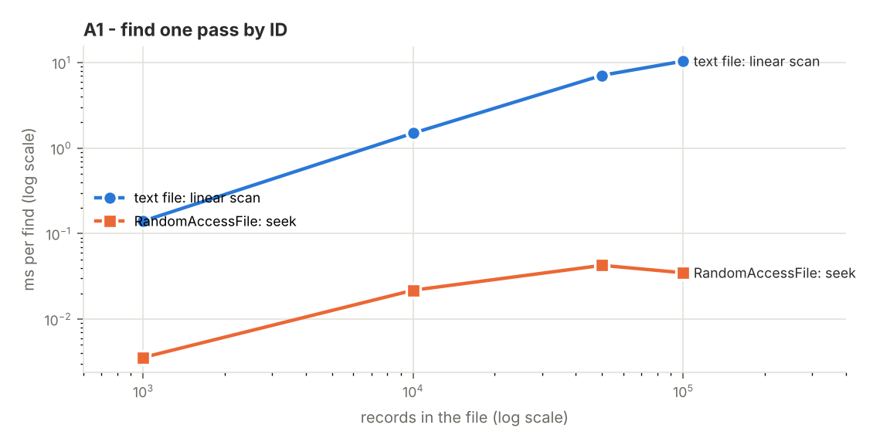{width=78%}

| Size for 100,000 passes | bytes | per record |
|---|---|---|
| Text (CSV + CRC) | 6,972,227 | 69.7 |
| Binary, DataOutputStream | 5,492,528 | 54.9 |
| Fixed 128-byte records | 12,800,000 | 128.0, of which **6,414,956 bytes (50.1 %) are padding** |

- **Time.** The text scan is **O(n)**, about 0.1 µs per record. The seek is **O(1)**: one 128-byte read, whatever n is. The small rise up to 50,000 records reflects the OS cache, not the algorithm.
- **Space.** Fixed records waste (field size − actual length) bytes in every padded field, which is O(n × average padding): here half the file. Text and binary store only what is there.
- **Costs.** Names over 30 characters must be refused or cut. Listing a route is still an O(n) scan. Changing a field size means rewriting the whole file.
- **Verdict.** For about 8,000 passes a year, a text scan takes about 1 ms, so the text design is good enough. The RAF design pays off only when many look-ups by ID meet a large file.

\newpage

# Task A2 – Don't Read What You Don't Need

## A2.1 Predicting the cost

`FileInputStream.read()` with no arguments returns **one byte per call**. Each call crosses from Java into native code and makes one `read(fd, buf, 1)` **system call** into the kernel.

- **Calls.** For 50 MB = 52,428,787 bytes, the prediction is **52,428,788 calls**: one per byte, plus the last call that returns −1.
- **Time.** Each call costs a system call and a user/kernel switch, a few hundred nanoseconds, while the actual work (comparing a byte with `'\n'`) is about a nanosecond. At about 0.35 µs per call, the expected time is about **18 s** for 50 MB.

**Verified** (B1.3):

- `strace` on the 1 MB file counted **1,048,541 read() calls for 1,048,540 bytes**: exactly the prediction (`TaskB1/output/SyscallCount_1MB.txt`).
- The 50 MB count took **17.8 s**, a measured 0.34 µs per byte.

## A2.2 Redesign with a buffer

```text
ALGORITHM CountLines(file)
    buffer <- new byte[65536]; lines <- 0
    OPEN in <- FileInputStream(file)                         // or BufferedInputStream(in, 8192)
        WHILE (n <- in.read(buffer)) > 0 DO                  // ONE call fills up to 64 KB
            FOR i <- 0 TO n - 1 DO
                IF buffer[i] = '\n' THEN lines <- lines + 1
            END FOR
        END WHILE
    CLOSE in
    RETURN lines
END
```

Buffering changes **how many times the OS is asked**, not how many bytes are read:

| Version | read() system calls for 1 MB (strace) | bytes per call | 50 MB time |
|---|---|---|---|
| `FileInputStream.read()` | 1,048,541 | 1 | 17,780 ms |
| `BufferedInputStream` (8 KB), `read()` per byte | 128 | 8,192 | 1,177 ms |
| `BufferedReader.readLine()` | 129 | 8,128 | 72 ms |
| own `byte[64 KB]` | 16 | 65,534 | 41.5 ms |

- **System calls.** 50 MB needs 6,400 calls with an 8 KB buffer and 800 with a 64 KB buffer.
- **The remaining cost.** `BufferedInputStream.read()` is still one Java method call per byte, and it takes an internal lock each time. That is why it sits 28× behind the array version even with 128 calls.

## A2.3 When buffering does not help

Buffering does not help when the program **already reads in large blocks**. `BufferedInputStream` passes any request of 8 KB or more straight to the file. Measured on 50 MB (median of 21 interleaved runs): `read(byte[64 KB])` took 32.3 ms with no buffer and 32.7 ms wrapped in a `BufferedInputStream`, so the wrapper adds nothing.

Other cases where a buffer gives little or no benefit:

- `Files.readAllBytes` of a small file, which is one read anyway;
- random access with `RandomAccessFile.seek`, where a read-ahead buffer is wasted;
- interactive or log output, where the data must leave immediately and needs `flush()`.

## Alternative – `Files.readAllLines()`

```text
ALGORITHM CountLinesAllAtOnce(file)
    lines <- Files.readAllLines(file, UTF-8)      // every line becomes a String in one List
    RETURN lines.size()
END
```

Measured on the 50 MB log (`TaskA2/output/ReadAllLines_1g.txt`, median of 5; heap = peak above the starting heap):

| Method | time | peak extra heap |
|---|---|---|
| `Files.readAllLines()` | 226 ms | **127.5 MB (2.55 × the file)** |
| `BufferedReader.readLine()` | 129 ms | 26.5 MB of short-lived garbage; live data O(one line) |
| `Files.lines()` stream | 141 ms | 30.0 MB of garbage; live data O(buffer) |
| `read(byte[64 KB])` | 87 ms | about 0, one 64 KB array |

With a small heap the difference becomes failure. `readAllLines` with `-Xmx64m` threw **`OutOfMemoryError: Java heap space`**, while `BufferedReader` counted all 1,059,123 lines with `-Xmx16m`.

- **Time.** Both are **O(file size)**.
- **Memory.** `readAllLines` is **O(file size)**. Every line becomes a `String` object held in the list: its characters plus about 40 bytes of object and array overhead, and a reference in the `ArrayList`. That gives roughly 2.5× the file for these 50-byte lines. Streaming is **O(buffer + longest line)**.
- **When `readAllLines` fits.** Small files (configuration, a few thousand records) that the program needs in memory anyway, e.g. to sort or search them many times.
- **When to stream.** Logs and data files whose size is not under the program's control, and any one-pass job such as counting, filtering or importing.

\newpage

# Task A3 – The Data-Access Design Pattern

## A3.1 The common pattern

The original classes, `TaskA3/src/before/StudentDB.java`, `CourseDB.java` and `MarksDB.java`, were run against the test database.

| Step | Repeated in all three classes | What differs |
|---|---|---|
| 1 Open | `DriverManager.getConnection(url, user, pwd)` | – |
| 2 Build SQL | string concatenation of values into `SELECT … WHERE` / `INSERT … VALUES` | table name, column list, key columns |
| 3 Execute | `createStatement()`, `executeQuery`/`executeUpdate` | query or update |
| 4 Map | `while (rs.next()) list.add(new X(rs.getString(…), …))` | the entity class and its fields |
| 5 Close | `rs.close(); st.close(); con.close();` (skipped if an exception occurs) | – |

The duplication is also where the defects are. The closing code is skipped on an exception, and the concatenated SQL breaks on a name like `D'Souza`. `StudentDB.add` failed with `SQLSyntaxErrorException: syntax error at or near "Souza"` (`output/A3Demo.txt`). It is also open to injection (A5.2).

## A3.2 A generic data-access interface

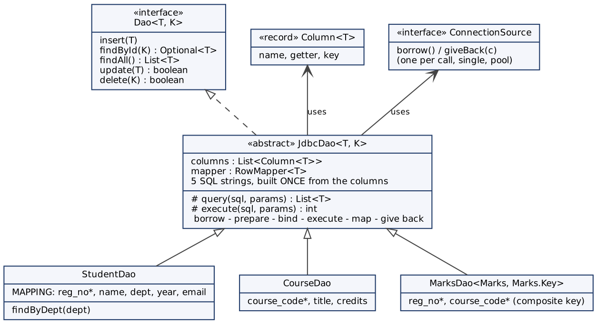{width=95%}

```java
public interface Dao<T, K> {
    void insert(T entity) throws SQLException;
    Optional<T> findById(K id) throws SQLException;
    List<T> findAll() throws SQLException;
    boolean update(T entity) throws SQLException;   // false if no row has that key
    boolean delete(K id) throws SQLException;
}
```

`JdbcDao<T, K>` writes the five steps **once**, in `query()` and `execute()`, using PreparedStatement and try-with-resources. It also generates the five SQL statements once from a column list. A concrete DAO supplies only what differs:

```java
public class StudentDao extends JdbcDao<Student, String> {
    static final List<Column<Student>> MAPPING = List.of(
            Column.key("reg_no", Student::regNo), Column.of("name", Student::name),
            Column.of("dept", Student::dept), Column.of("year", Student::year), Column.of(EMAIL, Student::email));
    public StudentDao(ConnectionSource src) {
        super(src, "student", MAPPING,
              rs -> new Student(rs.getString(1), rs.getString(2), rs.getString(3), rs.getInt(4), rs.getString(5)),
              regNo -> new Object[]{regNo});
    }
}
```

Generated and executed SQL: `INSERT INTO student (reg_no, name, dept, year, email) VALUES (?, ?, ?, ?, ?)`, `SELECT … WHERE reg_no = ?`, `SELECT … ORDER BY reg_no`, `UPDATE student SET name = ?, dept = ?, year = ?, email = ? WHERE reg_no = ?` and `DELETE FROM student WHERE reg_no = ?`.

The demo ran these calls:
- insert, including `D'Souza`, which now works;
- findById for an existing and a missing key (the missing one returns `Optional.empty`);
- findAll and findByDept;
- update of an existing and an unknown key (`true`/`false`);
- delete, then delete again (`true`/`false`).

`CourseDao` follows the same pattern, and `MarksDao` adds a **composite key** `Marks.Key(regNo, courseCode)`. Each is about 10 lines.

## A3.3 Object–table mapping

The mapping below was checked against the live table with `DatabaseMetaData.getColumns` and `getPrimaryKeys`:

| Student field | Column | SQL type | Nullable | Key |
|---|---|---|---|---|
| regNo : String | reg_no | CHAR(9) | NO | **PRIMARY KEY** |
| name : String | name | VARCHAR(60) | NO | |
| dept : String | dept | VARCHAR(10) | NO | |
| year : int | year | SMALLINT (CHECK 1–4) | NO | |
| email : String | email | VARCHAR(80) | YES | |

## Alternative – SQL written directly in the service and GUI classes

`TaskA3/src/inline/StudentService.java` (5 methods) and `StudentScreen.java` (3 methods) each contain their own SQL. They use safe PreparedStatements, so only the design differs. The column `email` was then renamed to `email_id` with `ALTER TABLE` (`output/RenameExperiment.txt`):

| | Inline SQL | Generic DAO |
|---|---|---|
| Places that name the column | **10 string literals in 2 files** (SQL text and `rs.getString("email")`) | **1 line**: the `EMAIL` constant in `StudentDao` |
| Operations broken by the rename | **7 of 8**; each must be found and fixed by hand | 5 of 6, until the one line changes |
| After the one-line change | – | **0 of 6 broken** |

Time per `findById` on a 1,000-row table, median of 7 interleaved rounds (`output/OpTiming.txt`):

| Design | µs per call |
|---|---|
| Inline SQL (prepare + execute + map) | 120.3 |
| Generic DAO (same SQL, plus lambdas and an `Object[]`) | 118.9 |
| Original classes (new connection + Statement per call) | **6,642** |

- **Time.** The two designs cost the same per operation, **O(1) extra**: a virtual call, a lambda call and a small parameter array, a few nanoseconds against a 120 µs database round trip.
- **Space.** The DAO adds O(1) per entity type: 5 SQL strings and 5 `Column` objects, under 2 KB.
- **Where the real difference lies.** The rename cost is **O(number of places that name the column)**: 10 places for the inline design, 1 for the DAO.
- **The biggest cost.** It belongs to neither design: opening a connection for every call takes 55× longer than the query itself (password login plus a new session). A DAO built on a `ConnectionSource` can use a pool without changing any caller.

\newpage

# Task A4 – What Should Be Serialized?

## A4.1 Deciding what to persist

| Field of Resident | Persist? | Reason |
|---|---|---|
| name, regNo | yes | the data the hostel must keep |
| password | **transient** | a secret must never be written to a file in clear text. Measured: without `transient` the file **contains `Secret#2026` in plain text**. Store only a salted hash, in the database, if it is needed at all. |
| Connection db | **transient** | a live socket/session is meaningless after a restart and is **not Serializable**. Without `transient`, `writeObject` failed with `NotSerializableException` (`output/GraphDemo.txt`). |

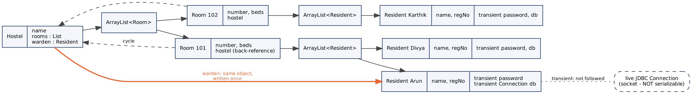{width=95%}

**What happens to the object graph.** `writeObject(hostel)` writes the Hostel and, recursively, **every object reachable from it** through non-transient fields: ArrayList → Rooms → ArrayLists → Residents → Strings. Each object is written once and gets a handle; a second reference to it is written as a back-reference. Verified after reading the file back:

- **Shared objects:** `back.warden == room101.residents[0]` is **true**. The warden is the same object, not a copy.
- **Cycles:** `room.hostel == back` is **true**. The Room → Hostel back-reference does not cause an infinite loop.
- **Transient fields:** `password` and `db` come back as **null**. The program must re-attach a Connection and authenticate again.
- **Construction:** the loaded objects are new, and constructors of `Serializable` classes are not run.

The 3-resident hostel took 501 bytes and contained no password.

## A4.2 Planning for change: the new `phone` field

Four versions of `Resident` were compiled and used to write and read files across versions (`TaskA4/versions/`, `output/VersionDemo.txt`):

| Case | Result |
|---|---|
| `serialVersionUID = 1L` in both versions; old file (no phone) read by new class | **Loads.** `phone` is missing in the stream so it gets the default (null). A `readObject` hook replaces it with "(not recorded)". |
| `serialVersionUID = 1L`; new file read by old class | **Loads**; the unknown `phone` value is ignored |
| No `serialVersionUID`; old file read by new class | **`InvalidClassException: local class incompatible: stream classdesc serialVersionUID = -7435966155176557058, local class serialVersionUID = -7378081878039426`** |

Without an explicit `serialVersionUID`, the JVM computes one from the class's name, fields and methods, so adding a field changes it and every saved file becomes unreadable. The rule: declare `private static final long serialVersionUID = 1L;` from the first version. Change it only for a truly incompatible change, such as changing a field's type or removing a field the readers depend on.

## Alternative – CSV or JSON text instead of serialization

`TaskA4/src/HostelFormats.java` writes only the persistent fields: hostel, room, beds, name and reg_no. Leaving the transient fields out is simply not writing them. Readers look fields up **by name** (a CSV header or JSON keys). Measured, median of 5 (`data/a4_formats.csv`):

| Residents | Format | File size | Save | Load |
|---|---|---|---|---|
| 10,000 | Java serialization | 442,722 B | 7.2 ms | 13.2 ms |
| 10,000 | CSV | 520,319 B | 4.8 ms | 7.3 ms |
| 10,000 | JSON | 557,431 B | 6.7 ms | 6.0 ms |
| 100,000 | Java serialization | 4,524,222 B (45.2 B each) | 117 ms | 174 ms |
| 100,000 | CSV | 5,302,919 B (53.0 B each) | **22 ms** | **92 ms** |
| 100,000 | JSON | 5,673,931 B (56.7 B each) | 50 ms | 108 ms |

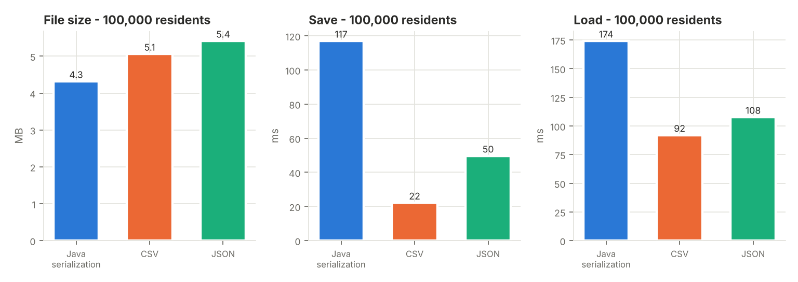{width=100%}

**Complexity.** All three are **O(n)** in time and file size.

- **Java serialization:** the smallest files, because class descriptions are written once and strings are deduplicated by handle. It is also the slowest here, because it tracks every object in a handle table and uses reflection.
- **CSV and JSON:** larger files, because field names or delimiters repeat for every resident, but faster and **readable by any language or tool**.
- **Coping with a new field:**
  - a header- or key-based reader gives old files a default ("(not recorded)") and ignores unknown new columns, with no version number needed;
  - a positional CSV reader that expects 5 fields breaks on the 6-field file.
- **Verdict.** Serialization only copes with a new field if the `serialVersionUID` was fixed from the start. It also ties the file to Java and to the class's internal structure, so a text format is safer for data that must outlive the program.

\newpage

# Task A5 – Design for Correctness and Safety

## A5.1 Transaction design: ₹500 from hostel wallet to canteen wallet

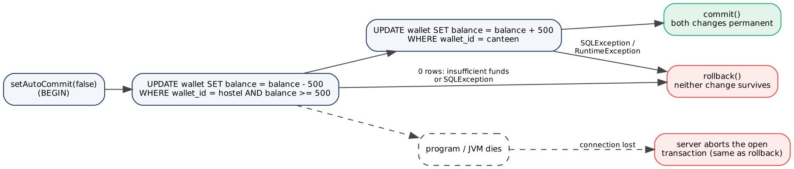{width=100%}

```text
ALGORITHM Transfer(con, fromWallet, toWallet, amount)
    IF amount ≤ 0 THEN REJECT "amount must be positive"
    oldAuto <- con.getAutoCommit()
    con.setAutoCommit(false)                                          // BEGIN
    TRY
        n <- EXECUTE "UPDATE wallet SET balance = balance - ? WHERE wallet_id = ? AND balance >= ?"
                     WITH (amount, fromWallet, amount)
        IF n ≠ 1 THEN THROW InsufficientFunds                         // missing wallet or too little money
        m <- EXECUTE "UPDATE wallet SET balance = balance + ? WHERE wallet_id = ?" WITH (amount, toWallet)
        IF m ≠ 1 THEN THROW WalletNotFound
        con.commit()                                                  // both changes become permanent together
    CATCH SQLException OR RuntimeException e
        con.rollback()                                                // neither change survives
        RETHROW e
    FINALLY
        con.setAutoCommit(oldAuto)
END
```

- **Guard against overdrawing.** The debit refuses to go below zero by itself (`balance >= ?`), and the table's `CHECK (balance >= 0)` is a second guard.
- **Lock order.** The implementation applies the two UPDATEs in wallet-ID order, so two opposite transfers cannot deadlock (`TaskA5/src/WalletService.java`).

Results (`output/A5Experiment.txt`; start: hostel ₹2,000 and canteen ₹500, total ₹2,500):

| Case | Hostel | Canteen | Total |
|---|---|---|---|
| Transaction, no failure | 1,500 | 1,000 | 2,500 ✔ |
| Transaction, **exception after the debit** → rollback | 1,500 | 1,000 | 2,500 ✔ (unchanged) |
| Transaction, **a separate JVM halted** after the debit (`Runtime.halt`, no finally) | 2,000 | 500 | 2,500 ✔: the server aborted the open transaction |
| Transfer of ₹5,000 (insufficient funds) | 2,000 | 500 | 2,500 ✔ refused |

## A5.2 Injection analysis

```java
String sql = "SELECT * FROM users WHERE id='" + id + "' AND pwd='" + pwd + "'";
```

The input is pasted **into the SQL text**, so a quote in the input ends the string literal, and whatever follows is parsed as SQL. Typing the user name `admin' -- ` produces

```sql
SELECT * FROM users WHERE id='admin' -- ' AND pwd='anything'
```

`--` starts a comment, so the password test disappears and the query returns the admin row: **login without a password**. With `x' OR '1'='1` in both fields, the condition becomes always true and the query logs in as the first user in the table. All of this was demonstrated on the test database (B2).

**Safe redesign.** The SQL text is fixed, and the values travel separately as parameters, so they can never become SQL:

```java
String sql = "SELECT id, full_name, role FROM users WHERE id = ? AND pwd = ?";
try (PreparedStatement ps = con.prepareStatement(sql)) {
    ps.setString(1, id);
    ps.setString(2, pwd);                   // in a real system: compare a salted hash, never the plain password
    try (ResultSet rs = ps.executeQuery()) { return rs.next() ? rs.getString("full_name") : null; }
}
```

## Alternative – two separate auto-commit statements

With auto-commit on, **each UPDATE is its own transaction and is committed the moment it finishes**. A failure between them leaves the debit committed and the credit never made:

| Case (auto-commit) | Hostel | Canteen | Total |
|---|---|---|---|
| Exception after the debit | 1,000 | 1,000 | **2,000: ₹500 lost** |
| Separate JVM halted after the debit | 1,500 | 500 | **2,000: ₹500 lost** |
| 4 threads × 250 random transfers, 5 % failing mid-way | – | – | **₹10,000 → ₹7,505: ₹2,495 lost** (in one transaction: ₹10,000 → ₹10,000) |

**Time** (1,000 transfers, median of 5): **699 µs per transfer as one transaction, against 983 µs for two auto-commit statements.**

- **Why the transaction is faster.** Both do two UPDATEs, but the transaction has **one** commit (one forced write of the database log) instead of two. BEGIN and COMMIT are extra messages but cost little.
- **Cost of correctness.** Row locks are held for the duration of one transfer, which is short.
- **Risk.** With auto-commit, money is lost or created whenever the program, the network or the machine fails at the wrong moment. The risk grows with the number of transfers and is invisible until the books are reconciled.

\newpage

# PART B – IMPLEMENTATION & EXPERIMENTAL INVESTIGATION

# Task B1 – Implement and Instrument the File Store

## Complete the Code (`TaskB1/PassStore.java`)

```java
// TODO 1
try (BufferedReader r = Files.newBufferedReader(file)) {
    String line;
    while ((line = r.readLine()) != null) {
        String[] f = line.split(",", -1);       // -1 keeps empty trailing fields, so they count
        if (f.length != 5) continue;            // damaged line: skip it and keep searching
        if (f[0].equals(passId)) return f;
    }
}
return null;
```

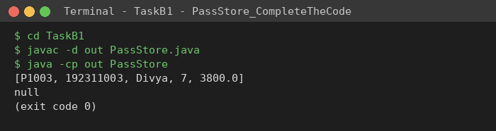{width=55%}

The output equals the expected output exactly: `[P1003, 192311003, Divya, 7, 3800.0]` and then `null`.

**Why the damaged line for P1002 does not stop the search.** Each line is handled on its own. `P1002,DAMAGED LINE` splits into 2 fields, so `continue` moves to the next line without returning or throwing. The loop still reaches P1003. P1002 itself returns `null` because its only line is damaged, and an untrustworthy record is reported as not found rather than returned with missing fields.

## B1.1 Validating the A1 store (`PassFileStore.java`, `output/PassFileStoreTest.txt` – 17/17 PASS)

| ID | Test | What it verifies | Result |
|---|---|---|---|
| T1 | find P1001 (normal) | a stored pass is found with all its fields | `P1001/Arun Kumar/12/4500.00` |
| T2 | find P9999 (does not exist) | a missing ID gives "not found", no exception | not found |
| T3 | list route 12 | only that route, in file order | [P1001, P1003] |
| T4–T5 | names `Rao, Arun` and `Divya "DJ" R` | delimiter and quotes survive (quoting) | round trip exact |
| T6 | find P1006 after a damaged line | a damaged line does not stop the search | found |
| T7 | P1005 with its amount edited by hand | CRC detects a valid-looking edit | not found, "line 7: checksum mismatch" |
| T8 | load everything | all bad lines reported, valid ones kept | 4 valid, 3 damaged (lines 5, 6, 7 with reasons) |
| T9 | half a record written (power failure), then add P1008 | the next add starts a new line; the fragment is detected | P1008 found; P1007 "expected 8 fields, found 5" |
| T10 | add route 150 | validation on write | refused, file unchanged |
| T11 | add a name containing a line break | one record = one line | refused |
| T12–T13 | find in, then add to, a missing file | no crash; file created with its header | not found / "header + 1 record" |

## B1.2 Implementation compared with the pseudocode

The implementation follows A1.2. Five changes were needed:

1. `add` uses a `FileChannel` with `force()` after the write instead of only `flush()`. `flush()` empties Java's buffer into the OS, but only `force` makes the record survive a power failure.
2. The "close a cut-short line" step needed a `RandomAccessFile` to read the last byte. A `BufferedReader` cannot look at the end of a file cheaply.
3. `find` compares the ID (text before the first comma) **before** decoding, so the CRC and type checks run only on the matching line. This kept find at about 0.1 µs per record.
4. Validation runs on add too: `add` decodes its own encoded line, so a record the reader would reject is never written (T10, T11).
5. The pseudocode said nothing about **duplicate pass IDs**. A text file cannot enforce uniqueness cheaply, because every add would need an O(n) scan. find returns the first valid record, and duplicates are caught during migration (B4) and by the database's primary key.

## B1.3 The effect of buffering (`output/BufferingBenchmark.txt`, median of 5; 50 MB unbuffered median of 3)

| File | `read()` per byte | BufferedInputStream | BufferedReader.readLine | read(byte[64 KB]) |
|---|---|---|---|---|
| 1 MB | 362 ms | 23.4 ms | 2.6 ms | 1.4 ms |
| 10 MB | 3,561 ms | 224 ms | 17.3 ms | 7.0 ms |
| 50 MB | **17,780 ms** | 1,177 ms | 71.7 ms | **41.5 ms** |

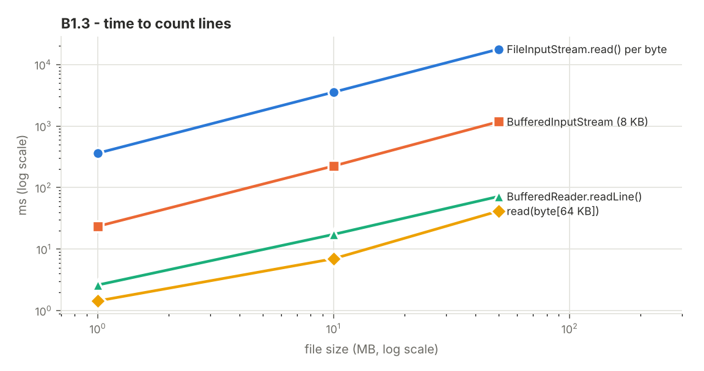{width=80%}

**Compared with the A2.1 prediction:**

- **Calls.** The number of calls matched exactly: 1,048,541 for 1 MB (`strace`).
- **Unbuffered time.** The predicted ~18 s for 50 MB matched: 17.8 s, a constant 2.8 MB/s, so time grows linearly with size.
- **Buffered stream.** `BufferedInputStream` brought the calls down 8,192× but the time only 15×. The rest is the per-byte Java method call with its internal lock, which A2.2 anticipated.
- **Bulk reads.** Reading 64 KB at a time removes both costs and is **428× faster** than unbuffered.

## B1.4 Growth of find (`output/GrowthBenchmark.txt`, median of 15)

| Records | file size | first record | middle | last | ID not present |
|---|---|---|---|---|---|
| 1,000 | 68 KB | 0.08 ms | 0.42 ms | 0.76 ms | 0.69 ms |
| 10,000 | 681 KB | 0.04 ms | 0.64 ms | 1.27 ms | 1.24 ms |
| 50,000 | 3.4 MB | 0.03 ms | 2.67 ms | 5.31 ms | 5.05 ms |
| 100,000 | 6.8 MB | 0.03 ms | 8.52 ms | 9.86 ms | **9.94 ms** |

**The trend.** find is a linear scan:
- The first record is found at once, whatever the size.
- A missing ID costs a full scan, which grows in proportion to n: about 0.1 µs per record, so 100,000 records take 10 ms.
- The middle record costs about half of that.

The 1,000-record row is slower per record because of start-up (JIT and file opening).

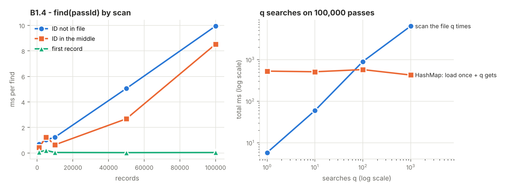{width=100%}

## Alternative – read once into `HashMap<String, String[]>`

```text
ALGORITHM LoadIndex(file)                 // once, at start-up: O(n) time, O(n) memory
    map <- empty HashMap
    FOR EACH valid line IN file DO map.putIfAbsent(line.passId, fields(line)) END FOR
    RETURN map
ALGORITHM Find(map, id)                   // each search: O(1) average
    RETURN map.get(id)
```

For q searches on n passes, the scan costs **O(q × n)** and the map **O(n + q)**. Measured at n = 100,000:

| q searches | scan the file each time | HashMap: build + lookups |
|---|---|---|
| 1 | 5.8 ms | 528 ms |
| 10 | 59 ms | 509 ms |
| 100 | 896 ms | **574 ms** |
| 1,000 | 6,379 ms | **425 ms** |

- **Crossover.** Close to 100 searches: below that, scanning wins, because building the map costs as much as about 90 scans. The build decodes and checks every line.
- **Memory.** The map uses **O(n)** memory: 53.4 MB for 100,000 passes (about 560 bytes each, as 8 `String`s plus the array and map entry). The scan uses **O(1)**.
- **Freshness.** The map must be updated on every add, or it becomes stale if another program writes the file.
- **Verdict.** A counter that answers many queries a day should keep the index in memory. A one-off lookup should scan.

\newpage

# Task B2 – Engineer an Adversarial Input

The test users are in `sql/postgresql/01_schema.sql`: `admin`, `counter1` and `arun`, with plain-text passwords *only* because this is a throw-away test database.

Each attack was run against four checks (`TaskB2/output/InjectionLab.txt`):
- **unsafe** – the original concatenation;
- **PreparedStatement**;
- **escape quotes** – `'` doubled to `''`;
- **regex whitelist** – input must match a pattern.

| Attack (id / pwd) | Unsafe concatenation | PreparedStatement | What it reveals |
|---|---|---|---|
| A0 `arun` / `arun@123` (genuine) | logged in | logged in | baseline |
| A1 `arun` / `guess` | rejected | rejected | baseline |
| A2 `admin' -- ` / anything | **logged in as Transport Admin** | rejected | `--` turns the password check into a comment |
| A3 `x' OR '1'='1` in both fields | **logged in as Transport Admin** (first row) | rejected | a condition that is always true |
| A4 `arun` / `' OR ''='` | **logged in as Transport Admin** | rejected | knowing a user name is enough |
| A5 `nobody' UNION SELECT id, full_name, pwd, role FROM users WHERE role='ADMIN' -- ` | **"logged in as 'Adm!n#2026'"**: the admin's **password** shown as the name | rejected | data theft: any table can be read |
| A6 `x'; UPDATE users SET full_name='HACKED' WHERE id='admin'; --` | error, **but the UPDATE ran**: admin's name became HACKED | rejected | data changed: a second statement executes* |

\*PostgreSQL runs several statements sent in one simple query. MySQL Connector/J refuses them unless `allowMultiQueries=true`, but A2–A5 work on MySQL too.

**What the adversarial inputs reveal about the original design.** The program let the user write part of the SQL. A login check that "works" for all genuine inputs is no evidence of safety, because the attacker chooses the input. The fix is structural: SQL text and values must never be mixed.

## The damaged bus-pass file (`input/damaged_passes.csv`, `output/DamagedFileLab.txt`)

`MakeDamagedFiles.java` builds 17 lines, each a different attack. The A1-design store (`PassFileStore`) responded as follows:

| Line content | Response |
|---|---|
| valid passes P2001, P2012 | loaded |
| missing fields `P2002,…,2027-06-30` | "expected 8 fields, found 6" – skipped |
| amount `45OO.00` (letter O; checksum valid for the bad text) | "amount not a number: '45OO.00'" |
| empty line, blanks-only line | "empty line" ×2 |
| route `seven` / amount `-3800.00` / date `2027-02-30` | "route_no not a number", "amount out of range", "bad valid_until" |
| unbalanced quote `"Vignesh, R,…` | "unbalanced quote (line cut short?)" |
| unquoted comma `Priya,Das` | "expected 8 fields, found 9" |
| 10,000-character name | "checksum mismatch" |
| amount edited 4100 → 1 | "checksum mismatch" |
| record cut in half | "expected 8 fields, found 5" |
| name `Robert'); DROP TABLE bus_pass;--` | **loaded as text**: harmless in a file, and harmless in the database because B4 binds it as a parameter |
| pass_id P2001 twice | first valid record wins; duplicates handled at migration (B4) |

In total: 4 valid records, **12 damaged lines reported with reasons**, and `find(P2012)` still succeeds after all the damage.

The given 5-field `PassStore`, on the same attacks, revealed three weaknesses:
1. It **accepts** `45OO.0`, `seven` and `-3800.0`, because it checks only the *number* of fields.
2. It **loses a genuine pass** whose name is `"Das, Priya"`: the comma makes 6 fields and there is no quoting.
3. An empty line is (correctly) skipped.

Counting fields detects truncation, not wrong content. Delimiters need quoting, values need type and range checks, and only a checksum catches a plausible-looking edit.

## Alternative – escaping quotes or validating with a regular expression

| Approach | Attacks A2–A6 | Weakness demonstrated |
|---|---|---|
| Escape `'` as `''` then concatenate | blocked | **A7: `\' OR 1=1 -- `.** Where backslash escapes are on (MySQL's default; PostgreSQL with `standard_conforming_strings=off`), `\'` is read as an escaped quote, so the added `'` closes the string: **logged in as Transport Admin.** Safety depends on server settings and on remembering every quoting rule. |
| Regex whitelist on id and password | blocked | **A8.** A genuine user whose password is `D'Souza 2026` is **locked out**, and the unsafe version crashes on it with a syntax error. The pattern must forbid legitimate characters to be safe, and every new field needs a new correct pattern. |
| PreparedStatement | blocked | none: the values are never parsed as SQL, so every character is allowed |

Time per login check (2,000 genuine logins per round, 9 interleaved rounds, median):

| Method | µs per login |
|---|---|
| unsafe concatenation (Statement) | 64.8 |
| escape quotes + Statement | 74.3 |
| regex whitelist + Statement | 78.3 |
| PreparedStatement, prepared on every call | 82.3 |
| **PreparedStatement, prepared once and reused** | **23.4** |

- **Validation cost.** Validation alone costs 0.2 µs (regex) or 0.015 µs (escaping) per login. That is **O(input length)** and negligible next to the round trip.
- **Statement.** It sends new SQL text that the server must parse and plan every time.
- **Prepared once.** A PreparedStatement prepared once sends only the values, so the server reuses its parse. It was the fastest *and* the only correct option.
- **Prepared every call.** It costs one extra parse, about the same as a Statement.

\newpage

# Task B3 – Statement vs PreparedStatement vs Batch

The table is `bus_pass(pass_id VARCHAR(10) PRIMARY KEY, reg_no CHAR(9), name VARCHAR(60), route_no INT CHECK 1–99, amount NUMERIC(8,2) CHECK ≥ 0, …)`, defined in `sql/postgresql/01_schema.sql` and `sql/mysql/01_schema.sql`.

## B3.1 Correctness on 10 records (`output/B3Lab.txt`)

Each approach inserted the same 10 passes, including `Priya D'Souza`; the Statement version must escape the quote by hand. A SELECT confirmed **10/10 rows identical to the input for all three approaches**. `ResultSetMetaData` reported:

| # | Column | Type name | java.sql.Types | Precision | Scale | Java class |
|---|---|---|---|---|---|---|
| 1 | pass_id | varchar | VARCHAR | 10 | 0 | String |
| 2 | reg_no | bpchar | CHAR | 9 | 0 | String |
| 3 | name | varchar | VARCHAR | 60 | 0 | String |
| 4 | route_no | int4 | INTEGER | 10 | 0 | Integer |
| 5 | amount | numeric | NUMERIC | 8 | 2 | BigDecimal |
| 6 | boarding_stop | varchar | VARCHAR | 40 | 0 | String |
| 7 | valid_until | date | DATE | 10 | 0 | java.sql.Date |

On MySQL the type names read VARCHAR, CHAR, INT, DECIMAL and DATE.

## B3.2 Increasing the data size (auto-commit on, as a program does by default)

| Approach | 1,000 rows | 10,000 rows | 100,000 rows | µs/row |
|---|---|---|---|---|
| (a) Statement | 380 ms | 3,564 ms | 34,264 ms | 343 |
| (b) PreparedStatement | 384 ms | 3,194 ms | 35,073 ms | 351 |
| (c) PreparedStatement + addBatch/executeBatch (1,000) | 256 ms | 2,711 ms | 28,800 ms | 288 |
| (a) Statement, inside **one transaction** | 77 ms | 803 ms | 8,953 ms | 90 |
| (b) PreparedStatement, inside one transaction | 56 ms | 712 ms | 7,148 ms | 71 |
| (c) batch inside one transaction (PassLoader, B3.3) | 31 ms | 335 ms | 2,644 ms | **26** |

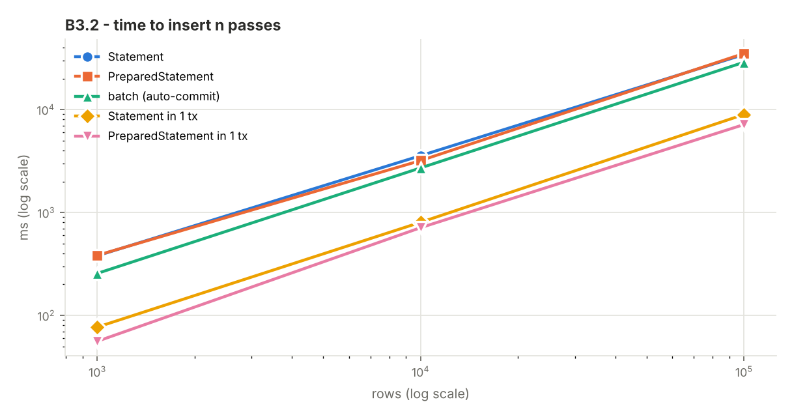{width=82%}

All approaches are **O(n)**. What differs is the constant, which is set by how many **commits** and **round trips** each row needs:

- **With auto-commit, all three are slow** (290–350 µs/row). Every row is its own transaction, and every commit waits for the database log to be forced to disk. JDBC requires each statement of an auto-commit batch to be committed on its own, so batching saves only the round trips.
- **Inside one transaction**, the commit cost disappears:
  - PreparedStatement beats Statement (71 vs 90 µs/row), because the SQL is parsed once and only values are sent;
  - batching removes the per-row round trip as well, at 26 µs/row: **13× faster than auto-commit Statement**.

## B3.3 Auto-commit vs one transaction, and a failure half-way

| Batch insert | 10,000 rows | 100,000 rows |
|---|---|---|
| batch with auto-commit | 2,600 ms | 28,663 ms |
| batch in one transaction (`PassLoader.loadAll`) | 242 ms | **2,311 ms (12× faster)** |

**Forced failure.** 10,000 passes, with pass P105000 given an invalid amount:

| Failure | Auto-commit batch: table afterwards | One transaction: table afterwards |
|---|---|---|
| amount `-500` (database CHECK violation) | **4,999 rows (P100001–P104999)**: a *partial* load; later rows were never sent | **0 rows**: rolled back |
| amount `abc` (NumberFormatException in Java before sending) | **4,000 rows**: the 4 batches already sent stay committed | **0 rows** |

With auto-commit, a failure leaves an unknown amount of the file in the table. Re-running the import then collides with the rows already there, and someone must work out which passes are missing. With one transaction the outcome is all or nothing, so the file can be fixed and simply loaded again.

## Complete the Code (`TaskB3/src/PassLoader.java`)

```java
for (String[] p : passes) {
    // TODO 1
    ps.setString(1, p[0]);
    ps.setString(2, p[1]);
    ps.setString(3, p[2]);
    ps.setInt(4, Integer.parseInt(p[3]));          // NumberFormatException (a RuntimeException) if not a number
    ps.setDouble(5, Double.parseDouble(p[4]));
    ps.addBatch();
    if (++n % 1000 == 0) ps.executeBatch();        // send 1,000 rows, keep the transaction open
}
ps.executeBatch();
// TODO 2
con.commit();
return n;
} catch (SQLException | RuntimeException e) {
// TODO 3
con.rollback();
throw e;
}
```

| Call | Returned | Time | `SELECT COUNT(*)` | Auto-commit restored |
|---|---|---|---|---|
| `loadAll(1,000)` | 1,000 | 31 ms | 1,000 | true |
| `loadAll(10,000)` | 10,000 | 335 ms | 10,000 | true |
| `loadAll(100,000)` | 100,000 | 2,644 ms | 100,000 | true |
| 10,000 with amount `-1.0` at pass P105001 | `BatchUpdateException` (check constraint `bus_pass_amount_check`) | – | **0 rows remain** | true |

## B3.4 Engineering trade-off

**(a) Nightly import of 100,000 passes.** Use `PreparedStatement` batches of about 1,000 inside **one transaction** (`PassLoader`), or the database's bulk loader for very large files (see the alternative below). It is about 12× faster than auto-commit, and it is all-or-nothing, so a bad record never leaves a half-loaded table.

**(b) A single pass issued at the counter.** Use **one PreparedStatement** (prepared once per counter session) with a short transaction around the pass and any related updates, such as a payment. Batching gives nothing for one row, and the clerk needs the result, including a duplicate-ID error, immediately.

## Alternative – multi-row INSERT and bulk load (COPY / LOAD DATA)

```text
multi-row: INSERT INTO bus_pass(...) VALUES (?,?,?,?,?), (?,?,?,?,?), ... (b groups)   -- one statement per b rows
bulk load: COPY bus_pass(...) FROM STDIN WITH (FORMAT csv)     -- PostgreSQL
           LOAD DATA LOCAL INFILE 'passes.csv' INTO TABLE bus_pass FIELDS TERMINATED BY ','   -- MySQL
```

Measured on 100,000 rows in one transaction (median of 3). Memory is the client heap held while one batch is pending, measured after GC (`data/b3_alternatives.csv`).

| Approach | Time | Rows/s | Client memory for one batch |
|---|---|---|---|
| batch, b = 100 | 2,629 ms | 38,031 | 13.7 KB |
| batch, b = 1,000 | 2,600 ms | 38,458 | 137.6 KB |
| batch, b = 10,000 | 2,284 ms | 43,781 | 1,383 KB |
| multi-row INSERT, b = 100 | 1,156 ms | 86,492 | 9.4 KB |
| multi-row INSERT, b = 1,000 | 1,015 ms | 98,517 | 93.8 KB |
| **COPY FROM STDIN (streamed)** | **428 ms** | **233,695** | 64 KB (fixed buffer) |

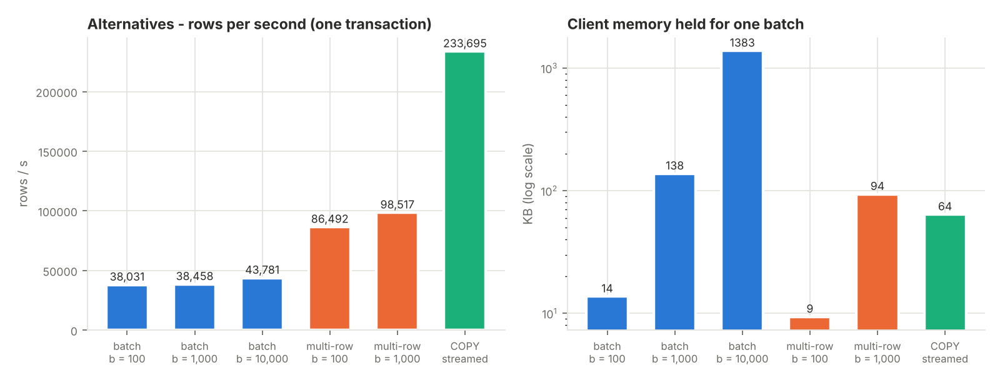{width=100%}

**Time.** All are **O(n)**, but the cost per row falls as more of the per-row work moves inside the server:

- **Batch:** n executions, each with its own Bind/Execute message and result.
- **Multi-row INSERT:** n / b statements, each parsing and executing b rows at once, about 2.5× faster than the batch.
- **COPY / LOAD DATA:** one command and one stream of rows, with no per-row statement at all, about 6× faster than the batch.

**Memory.**

- **Batch:** a pending batch holds **O(b)** parameter arrays, about 140 bytes per row.
- **Multi-row INSERT:** O(b) as well, plus an SQL string with 5b placeholders. The number of parameters is also limited: PostgreSQL allows 65,535, so at most 13,107 rows per statement; MySQL limits the packet size.
- **COPY / LOAD DATA:** streams with an **O(1)** buffer.

**Costs of the faster options.**

- **COPY / LOAD DATA:**
  - It is not portable: each database has its own syntax, and MySQL needs `local_infile` enabled.
  - It reports errors less precisely: one bad line aborts the whole COPY.
  - It bypasses per-row application validation, so the data must be validated first (B4 does this).
- **Multi-row INSERT:** it has to be built by hand. On MySQL, `rewriteBatchedStatements=true` makes Connector/J do this automatically for a normal batch.

**Verdict.** Batches inside a transaction are the portable default. Bulk load is worth it for the largest nightly imports.

\newpage

# Task B4 – Final Engineering Decision

## B4.1 Migration with a failure report (`TaskB4/src/MigratePasses.java`)

```text
ALGORITHM MigratePasses(file, campus)
    con.setAutoCommit(false); seen <- empty map id -> line
    sql <- INSERT ... VALUES (8 parameters) ON CONFLICT (pass_id) DO NOTHING      // MySQL: INSERT IGNORE
    FOR EACH line (lineNo) IN BufferedReader(file) DO                              // streamed
        IF header THEN CONTINUE
        TRY p <- Decode(line) CATCH Damaged e: Report(lineNo, e.reason); CONTINUE   // A1 checks + CRC
        IF seen contains p.id THEN Report(lineNo, "duplicate in file, first at line " + seen[p.id]); CONTINUE
        seen[p.id] <- lineNo; Bind(p, campus); addBatch()
        IF batch has 1,000 rows THEN counts <- executeBatch(); count 0 = "already in database" (reported)
    END FOR
    executeBatch(); con.commit()                                // all valid rows, or (on any error) rollback: none
END
```

Run on a year's file for campus 1 (`input/passes_campus1_2025.csv`: 8,000 passes with realistic damage; `output/Migration_run1.txt`):

| Lines | Valid | Inserted | Already in database | Duplicate in file | Damaged | Time |
|---|---|---|---|---|---|---|
| 8,001 | 7,906 | **7,906** | 0 | 11 | 83 | 651 ms |

The failure report `output/migration_failures_run1.csv` lists 94 entries, each with line number, pass ID, reason and text:

| Failure | Count |
|---|---|
| bad date `2027-13-01` | 21 |
| checksum mismatch (hand edits) | 15 |
| route `R16` and similar | 22 |
| cut-short lines | 13 |
| empty lines | 12 |
| duplicate pass IDs | 11 |

**A second run of the same file** inserted **0** rows and reported all 7,906 as "already in the database – skipped". The migration can be repeated safely after the damaged lines are corrected.

## B4.2 Inspecting the database (`output/InspectDatabase.txt`)

| DatabaseMetaData call | Value |
|---|---|
| `getDatabaseProductName/Version` | PostgreSQL 16.15 |
| `getDriverName/Version` | MiniPg JDBC (CSA09 test driver) 0.1 |
| `getJDBCMajor/MinorVersion` | 4.2 |
| `getURL`, `getUserName` | jdbc:minipg://127.0.0.1:5432/csa09_a5, csa09 |
| `supportsTransactions`, default isolation | true, READ COMMITTED |
| `supportsBatchUpdates` | true |
| `getTables(…"TABLE")` | bus_pass, course, marks, student, users, wallet |
| `getColumns("bus_pass")`, `getPrimaryKeys` | 8 columns with types, sizes and nullability; PK pass_id |

**Why this matters when the application moves to another server.**

- **Server and driver.** The program can **check, at start-up, what it is really talking to**: product and version (which SQL dialect, whether CHECK constraints are enforced, e.g. MySQL < 8.0.16 ignores them) and which driver and JDBC version is loaded.
- **Capabilities.** It can confirm that the server supports transactions and batch updates.
- **Schema.** It can check that every table it needs exists with the expected columns. Our check printed "all 6 tables the application needs are present".

A wrong server, a missing migration or an old driver is then reported clearly at start-up, instead of failing later in the middle of issuing a pass.

## B4.3 Production decision

**Decision: one shared relational database (MySQL/PostgreSQL), accessed through PreparedStatements in short transactions; text files only for import/export, and no serialization for the records.**

The requirement is 12 campuses, 100× today's passes (about 800,000) and several counters issuing passes at the same time. `ScaleExperiment` measured it by migrating 12 campus files of 66,667 passes (`output/ScaleExperiment.txt`):

| Requirement | Database (measured) | Text file (B1) | Serialized files (alternative, measured) |
|---|---|---|---|
| Load 800,000 passes | 791,923 rows in **27 s** (29,000 rows/s) with validation and a failure report | – | – |
| Find one pass | **33 µs** (primary-key index, O(log n)) | ~80 ms, *estimated* from B1's 0.1 µs/record (O(n) scan) | **2,594 ms**: open and deserialize all 12 files; 29 ms even with everything already in memory |
| List one route | 48 ms (~19,700 rows, route index) | full scan | 29 ms if all lists are in memory |
| Several counters at once | 12 counters × 50 passes: **0.45 ms per pass, 0 lost**; 22 attempts at a duplicate pass ID rejected by the primary key | no locking; an append can interleave | no lock: **33 of 40 passes lost**; with a file lock: **0 lost but 499 ms per pass** |
| Safety | transactions (A5, B3.3), CHECK constraints, PreparedStatement (B2) | checksum only; no transactions | no transactions; readers crash on a file being rewritten (`EOFException`, `StreamCorruptedException`) |
| Space | 137 MB (table + 3 indexes) | ~55 MB, *estimated* at 69.7 B/record (A1) | 97.5 MB |

The database uses more disk space, about 1.4× the serialized files, because it keeps indexes and per-row headers. In exchange it is the only option that finds passes in microseconds, lets 12 campuses' counters work at the same time **without losing a pass**, enforces unique pass IDs and valid amounts, and recovers from crashes. Text files stay useful for the nightly import and for exports, using the A1 format with checksums and the B4 migration.

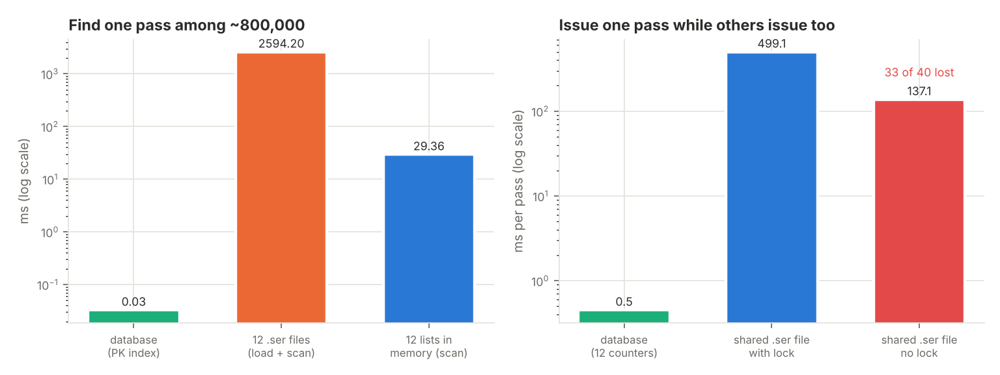{width=100%}

## Alternative – each campus keeps its own serialized file

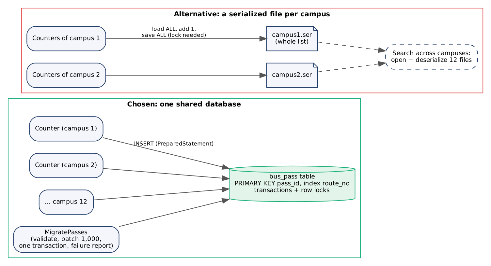{width=100%}

**What the solution would be.** Each campus program keeps a `List<SerialPass>` in memory and saves it with `ObjectOutputStream` after every change. A search across the university must open, deserialize and scan up to 12 files.

| | Shared database | 12 serialized files |
|---|---|---|
| Search all passes by ID | O(log n) index: 33 µs | O(n) per search plus deserializing O(n) objects: 2.6 s cold, 29 ms with all 12 lists in RAM |
| Space | O(n) rows + O(n) index entries: 137 MB | O(n): 97.5 MB on disk, **plus the whole list in each program's heap** |
| Issue one pass | O(log n): insert one row and its index entries | **O(n)**: rewrite the campus's whole file (66,043 passes) for every pass |

**Concurrent counters.**

- **Database:** row-level locking and transactions. The 12 counters ran in parallel with nothing lost, and the primary key turned a race for the same ID into a clean error for one counter.
- **Files without a lock:** read-modify-write races. 4 counters lost **33 of 40 passes**: 32 failed because they read a file another counter was writing, and 1 was silently overwritten.
- **Files with a lock:** an exclusive `FileLock` (plus a JVM monitor, because `FileLock` is per JVM) made the result correct but serialized every counter. Each pass then cost about 0.5 s.

Even a perfect file design cannot answer "which passes does this student hold on any campus" without reading all 12 files.

# Conclusion

| Task | Key evidence-based result |
|---|---|
| A1 | CSV with quoting and a CRC per line handles delimiters, damage and cut writes. RAF fixed records find by ID 299× faster at 100,000, but 50.1 % of the file is padding. |
| A2 | 52,428,788 single-byte read() system calls predicted; the 1 MB count was confirmed exactly by strace. 64 KB reads are 428× faster. readAllLines needs 2.55× the file in heap and fails with 64 MB. |
| A3 | One generic `Dao<T,K>` + `JdbcDao` removes the repeated five steps. A column rename touches 1 line instead of 10, at the same cost per call. |
| A4 | password and Connection are transient; the graph keeps shared objects and cycles. A fixed serialVersionUID keeps old files readable. CSV is 5× faster to save but 17 % larger. |
| A5 | A transaction conserved every rupee under exceptions, a JVM crash and 4 concurrent threads. Auto-commit lost ₹500 per failure (₹2,495 in the stress test). The transaction is also faster (699 vs 983 µs). |
| B1 | Complete the Code output matches. 17/17 store tests pass. Buffering matches the prediction. Scan grows at about 0.1 µs/record. A HashMap pays off after about 100 searches. |
| B2 | 5 injection attacks succeed against concatenation and 0 against PreparedStatement. Escaping fails with backslash escapes; regex locks out real users. The prepared statement is also the fastest (23 µs). |
| B3 | One transaction plus batches: 26 µs/row against 343 µs/row with auto-commit Statement. The transaction gives all-or-nothing loading (0 rows after a failure, against 4,999). COPY reaches 233,695 rows/s. |
| B4 | 791,923 passes migrated with a failure report, and the migration is safe to re-run. DatabaseMetaData start-up check. Decision: a shared database (33 µs search, 0 passes lost with 12 counters) over per-campus files (2.6 s, 33 of 40 lost). |
